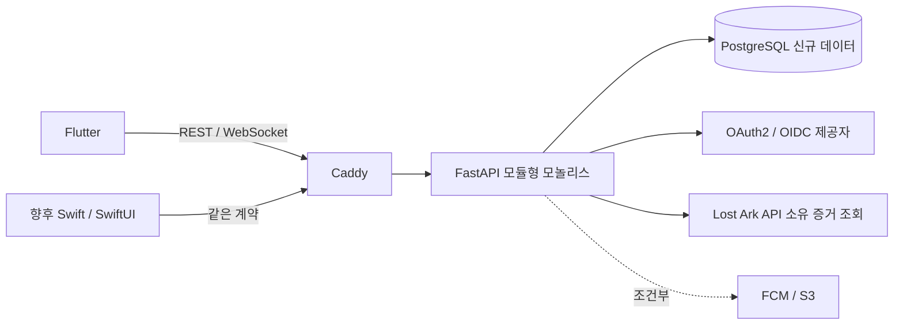

# FastAPI 신규 서버 구조 설계안

상태: 설계안 v0.1(미구현). 확정 요구는 [09](09-migration-decisions.md). endpoint·DTO·SQL table 설계는 backend 저장소에서 수행한다.

## 시스템 경계

Firebase는 신규 서버의 인증/데이터 source나 내부 호출 경로에 포함하지 않는다. 새로운 사용자의 login과 상태는 새 PostgreSQL에서 시작한다. 외부 OAuth·게임 API·조건부 push/file을 adapter로 분리한다. 클라이언트에는 DB credential/provider secret/signing secret을 두지 않는다.

## 기능 모듈과 데이터 책임

| 모듈(논리 이름) | 소유 책임 | 의존/서버 정책 |
|---|---|---|
| identity/session | 신규 사용자·provider identity·session/refresh·account 상태 | 모든 private 요청의 actor 결정. social login과 game ownership 별개 |
| game-ownership/character | server challenge·계정/Character identity·현재 owner/generation·공개 표시 | Lost Ark adapter,본인 login;source Snapshot은 권한 증거 아님 |
| party | 모집 metadata·membership/slot·신청/승인·권한·회차/반복·명령 revision | current ownership·group 자격·정원/배치·서버 원자 명령 |
| group | 그룹·leader/member·초대/신청/차단·join code | Player별 active limit와 group count·원자 관계,group leader와operator 구분 |
| weekly-status | Character/raid 주차 점유·완료·다음 주 준비 | 소유 generation·party cycle과 관계. 신규 DB에 legacy claim/assignment import 없음 |
| events/realtime | 권한별 persisted event·history·delivery/replay | command commit 결과로 event 생성,audience 서버 계산,WS 인가/회수 |
| operator/manual-verification | operator role·수동 인증/분쟁/감사 | private 권한·trusted evidence와status transition. 첫operator 별도 provisioning |
| shared-contract/time | error/category·ID 표현·catalog version·server clock | transport/DB와 분리된 공용 불변식. public serialization allowlist |

이는 schema가 아닌 모듈 ownership이다. 한 모듈이 다른 모듈의 SQL row를 임의 변경하는 것을 기본으로 하지 않는다. 여러 모듈에 걸친 command는 application service가 한 unit of work에서 정책을 조합한다. repository마다 중간 commit하면 안 된다. 공개 읽기 DTO와 내부 domain entity를 분리한다.

## 논리 데이터 관계 — 물리 테이블 미확정

신규 user ↔ provider identity/session, user → gameAccount ownership → Character, user ↔ group membership, party → members/slots/applications/cycles, Character+raid+cycle → participation/completion, command → event/audience가 설계 개념이다. 기존 `authBindings`·Firebase document ID 형식을 그대로 재현하지 않는다. user ID·Character ID·local int ID는 서로 다른 식별자다.

Firebase 원본/summary/listing을 모두 독립 writable entity로 옮기지 않는다. authoritative membership/slot과 query projection을 구분하고 그룹 모집은 관계형 원본 조회를 기본 후보로 삼는다. 기존 Snapshot의 역사 표시 필요는 신규 event/cycle 설계에 남긴다. 여러 주차의 완료 이력과 현재 점유는 개념을 분리하되 실제 저장 모델은 backend가 결정한다.

## 요청과 트랜잭션 흐름

transport 입력 해석 → session/actor 확인 → command/object scope 인가 → 관련 authoritative 상태/ownership 읽기 → version/주차/정원/전이 검증 → command 변경과 event 저장 → 한 commit → 응답과 notification hint. 실패는 rollback하고 partial effect를 남기지 않는다. 외부 OAuth/게임 API 호출은 장시간 DB lock을 잡은 채 수행하지 않고 증거 freshness·ownership을 최종 commit 단계에서 재검증하는 방식으로 설계한다.

권한은 FastAPI에서 모든 private command마다 검증한다. PostgreSQL은 존재/참조·유일성·행내 상태 제약을 보완한다. 그룹 정원이나 역할별 승인처럼 여러 row/현재 상태에 의존하는 정책을 단순 CHECK 하나로 처리할 수 있다고 가정하지 않는다. CHECK의 타 row 참조 한계와 UNIQUE/FOREIGN KEY 등을 검토한다. [PostgreSQL constraints](https://www.postgresql.org/docs/current/ddl-constraints.html).

async ORM을 선택하면 request/task 단위 Session lifecycle을 관리하며 concurrent task가 같은 AsyncSession을 공유하지 않는다. 작업 group commit/rollback은 application boundary가 소유한다. 이는 SQLAlchemy의 concurrency 지침을 따른다. [SQLAlchemy Session basics](https://docs.sqlalchemy.org/en/20/orm/session_basics.html). sync/async driver·구체 connection pool 값은 backend에서 정한다.

## 동시성·멱등성 설계 요구

- 같은 identity의 동시 첫 로그인,동일 Character/raid 점유,group membership·join code·command/event identity는 유일성 요구다. 물리 unique scope는 backend schema 검토에서 결정한다.
- room/group revision 또는 조건부 갱신과 lock 범위를 명령 단위로 정의한다. 최대8인과 마지막 자리 경쟁,동시 승계/해산을 transaction으로 검사한다.
- 명령 ID는 actor/environment/action scope와 request 의미를 결합해 재사용한다. 같은 ID+같은 의미 재전송은 같은 결과,같은 ID+다른 입력은 conflict가 되어야 한다. idempotency record 보관/조회 표현은 미확정이다.
- retry에서 외부 API/notification을 중복 발생시키지 않는다. 성공 응답 유실과 실패를 구분하고 stale client revision을 새 권한으로 자동 우회하지 않는다.
- KST 수요일06시 주차는 서버 clock이 판정하고 앱은 표시한다. boundary 이전/이후·다음 주 preparation·완료 state/ownership generation을 server에서 재검증한다.

## 이벤트·WebSocket과 외부 큐 없는 초기 운영

새 command 결과의 event는 domain 변경과 같은 transaction에 persisted한다. commit 전 push하지 않는다. 최종 확정된 결과를 다른 client가 REST/WS로 조회할 수 있어야 한다. socket emit 실패는 DB rollback이나 재명령 실행 이유가 아니다.

초기 운영 제안은 한 instance/한 ASGI process의 WS hub + PostgreSQL persisted events와 연결후 재조회/replay다. Redis/Kafka는 쓰지 않는다. 필요 시 DB 기반 pending delivery 상태/작은 poller를 같은 모놀리스에 두되 구현 결정은 후속이다. 여러 worker를 그냥 늘려 in-memory hub가 전체 audience를 공유한다고 주장하지 않는다. 증설 전에 cross-process delivery·dedup·capacity를 설계해야 한다.

WS는 public/own/group/room scope별 authorize,role/ownership/탈퇴/정지·session 만료 시 재인가/회수한다. 재연결 cursor·retention·ordering/dup·backpressure를 별도 WS 계약으로 정한다. URL query에 장기 bearer/refresh token을 넣지 않는 설계다. native header 또는 제한된 auth handshake/ticket 중 실제 플랫폼 지원에 따라 확정한다.

## 개발·운영 경계

Windows/WSL2에서 Docker Compose로 API·PostgreSQL·선택 Caddy를 구성하고 production target은 Lightsail Linux amd64다. compose/도메인/TLS/backup/secret/배포 스크립트는 이번에 생성하지 않는다. DB는 공개 인터넷 client가 직접 접근하지 않고 Caddy가 API/WS를 전달한다. mobile redirect/TLS domain이 정해져야 provider 등록을 완료할 수 있다.

health/readiness,request ID·명령 ID/권한 거절·DB 오류·event 지연 로그,secret/token redaction과 backup restore 검증은 운영 요구다. guest 개인 관심/서버 사용자 이력 저장은 금지하며 보안/서비스 로그 범위·보관은 별도 정책으로 최소화한다. 운영 용량·RPO/RTO·알림/S3 필요성은 미확정이다.

## 제외

기존 Firebase export/import/UID linking·legacy schema 호환 server·데이터 자동 삭제/복구·신뢰 없이 client ownership payload 채택·Cognito/Redis/마이크로서비스는 제외한다. 소스 분석의 예외/보안 문제를 그대로 새 서버에 복제하지 않는다. 실제 backend/DDL/OpenAPI/WS schema는12 작업 패키지로 인계한다.
