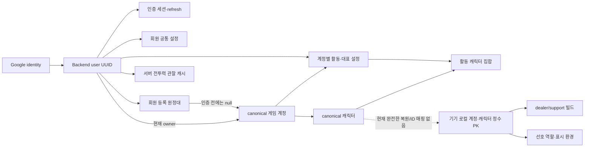

# 전체 데이터베이스 설계 재점검

2026-10-14. Issue6 마무리 뒤 사용자 요청으로 수행한 코드·계약 기반 점검이다. DB/기능 코드/실제 자료를 변경하지 않았다. 기존 Firebase/테스터 자료 이관은 없다.

## 결론

현재 회원/세션, 등록과 소유권, 캐릭터, 회원 설정을 분리한 서버 구조를 전면 재작성할 근거는 발견하지 않았다. 다만 **현재 서버 데이터는 앱 전체 환경을 복원할 만큼 완성되지 않았다.** 다음 네 항목을 구분해서 진행해야 한다.

1. 회원별 나이스단 설정은 서버 저장·앱 연결·사용자 확인 완료다. 전체 빌드 자동 갱신/저장 빌드 복원과는 별개다.
2. 계정·역할 빌드·표시 환경의 실제 정답이 서버/로컬 두 곳에 나뉘어 있다. 로컬 DB는 현재 회원별 구조가 아니므로, 로그인 복원 설계에서 회원 소유 자료와 기기/비로그인 자료의 경계를 확정해야 한다.
3. 전체 빌드/선호 역할/표시 순서·개수의 서버 저장 계약과 로컬 ID 연결이 없다. 서버 캐릭터 GET만으로 기존 로컬 화면을 재구성하는 연결도 아직 없다.
4. 로컬 삭제의 종속 자료 정리에 재현 가능한 문제가 있다. 격리 메모리 DB에서 foreign_keys=0이고, deleteMissingCharacter 뒤 빌드1행·주간표시1행이 남았다. 실제 기기 상태까지 검증한 것은 아니며 별도 최소 수정 구간이 필요하다.

## 조사 기준과 확인 한계

- Flutter 실제 코드: dev 통합 **5cee9648fe53ff259f967e402edfebd1f0a9a001**, 설정 기능 **2e0764f**. SQLite/Drift schemaVersion13, BackendApp의 실제 Router/DI까지 확인했다.
- Backend dev 조회 SHA **4eb23f5dc4048e75e4e27e9f56a2f6f0ec9cc940**: migration0003까지. 회원 설정을 포함한 게시 기준 **79255f0f77602c26a215bf0340331eb697417ff4**: migration0004. 조사 시점 두 기준은 동일하지 않다. Backend 마지막 회신상 feat/member-settings push·로컬0004적용, dev미병합이며 이 점검에서 Backend Git을 변경하지 않았다.
- Backend 원본: app/auth/models.py, app/game_accounts/models.py, app/member_settings/models.py, alembic/versions/0001~0004, auth/game cleanup, game service/support/power_service/observations 및 member_settings/service. 원본은 [고정 SHA](https://github.com/heo0328/lostparty-backend/tree/79255f0f77602c26a215bf0340331eb697417ff4), API snapshot은 [Issue6 원본](contracts/issue6-79255f0.openapi.json).
- 실제 PostgreSQL 접속/행 조회/개발자료 fixture/DDL 변경/운영 백업 복구는 하지 않았다. 소스 제약·서비스 흐름 대조이지 새 서버 전체 동시성 검증이나 운영 준비 완료 판정이 아니다.
- 임시 검증은 .dart_tool/db_design_audit_test.dart에서 새 NativeDatabase.memory()만 사용했다. 실제 기기/기존 lost_party 파일/Backend DB와 무관하다.

## 저장소와 연결 관계

등록관계는 소유권이 아니다. 미인증 등록은 preview JSON을 가지며 canonical account/character가 없어도 표시·전투력 조회가 가능하다. 게임 소유권은 별도 서버 증거 경로다. 로컬 server_name+character_name 표시 매칭도 소유권/UUID 연결의 증거가 아니다.

## PostgreSQL 물리 테이블 — 게시0004 기준 19개

아래 수는 업무/인증 모델만 센 것이다. Alembic 관리 테이블은 제외한다. dev0003은 이 중 member_settings를 제외한18개다.

| 테이블 | 식별·관계·주요 저장/제약 |
|---|---|
| users | UUID PK, active/disabled 상태, 생성/수정/로그인시각 |
| auth_identities | UUID PK→user FK, provider+issuer+subject UNIQUE. 이름/email이 아닌 identity로 같은 회원 연결 |
| auth_transactions | UUID PK, nonce_digest UNIQUE, secret_digest, 만료/소비시각 |
| auth_sessions | UUID PK→user FK, remember_me·절대/idle만료·폐기상태 |
| refresh_credentials | UUID PK→session FK, token_digest UNIQUE, session+generation/request_digest UNIQUE, successor 자체FK |
| refresh_recoveries | old credential UNIQUE/FK·successor FK, 제한회복 ciphertext/nonce/key_id·만료, resend_count0~2 |
| game_accounts | UUID PK, 현재owner user FK nullable, ownership_revision/roster_revision>0·검증시각 |
| game_account_registrations | UUID PK→user/account FK(account은nullable), label·is_main·preview JSONB·version·deleted_at. 미삭제 회원별main최대1, 미삭제(user,canonical account)중복금지 |
| game_characters | UUID PK→account FK, (server_name,character_name) UNIQUE, (account_id,id) UNIQUE, summary JSONB·confirmed/suspect/missing·시각 |
| character_settings | UUID PK→user/account FK, 대표는(account,character)복합FK, 미종료(user,account)최대1, state/version/next_change_at/ended_at |
| activity_characters | (settings_id,character_id) PK. settings/account와account/character복합FK로다른계정캐릭터혼합거절 |
| game_account_verifications | UUID PK→actor/registration/candidate FK, roster/baseline/slots/result JSONB, pending/verified/expired/cancelled·TTL/확인횟수 |
| ownership_audits | UUID PK→account/old/new user/challenge FK, challenge UNIQUE(nullable), 소유차수·시각 |
| game_account_requests | UUID PK, (actor,operation,key) UNIQUE, payload digest·state/generation/lease·완료status/result. 설정저장도기존멱등기반재사용 |
| game_account_limit_events | UUID PK, scope·시각 인덱스. 호출 제한의 단기 자료 |
| game_account_cache | 조회name PK, siblings roster JSONB·수집시각. 권한/소유 정답이 아님 |
| game_account_fetch_leases | 조회name PK, generation/완료여부/만료·roster/시각. 동시조회 합류용 |
| character_power_cache | (actor,server_name,character_name) PK→user FK, value/fetched/checked/status/reason·generation/lease. 회원별표시관찰값 |
| member_settings | user_id PK/FK, nice_group_auto_refresh_enabled boolean·version>=1·updated_at. 회원당최대1행 |

### DB 제약과 서비스 검증의 역할

- server 모델·migration에 회원main/활성설정의 partial UNIQUE와 계정/캐릭터 복합FK가 존재한다. 대표가 실제 활동 선택에 포함되는지, 현재 owner·세 revision·cooldown이 맞는지는 game_accounts/service.py의 트랜잭션 검증이다. DB FK만으로 모든 정책을 처리하는 구조는 아니다.
- 회원 설정은 GET 미설정일 때 false/version1을 계산한다. 명시PUT에서만행생성하고 실제값변경시에만version증가, stale expected_version은같은값이어도거절한다. migration에SQL DEFAULT가없지만서비스가명시초기값을넣으므로이를누락결함으로분류하지않는다.
- 멱등 reserve/replay에도현재회원/세션검증이있고,업무변경과commit_result는같은transaction이다. game-mutations-v1 직렬화는현재규모의기존선택이며처리량문제가실증된것은아니다. 증거없이별도큐/분산저장소를추가할이유는없다.
- 소유권 이전 시 owner/revision변경과이전설정ended_at·새설정생성/감사기록을서비스가묶는다. 실제장비/감소roster증거보류는여전히별도공동인수다.

## Flutter 기기 DB — Drift schema13, 8개 테이블

파일: lib/features/account/data/local/account_database.dart. 실제앱은 driftDatabase(name:'lost_party') 하나를 연다.

| 테이블 | 저장·식별 | 현재 BackendApp에서의 위치 |
|---|---|---|
| game_accounts | 로컬 int PK, label/main/조회이름·대표localID·displayLimit, nullable server계정/대표ID·소유상태 | 기기 공용 로컬 원정대. 회원/Backend origin 칼럼 없음 |
| account_characters | int PK→local account FK, 계정+서버+이름 UNIQUE, nullable serverCharacterId, 프로필/수치·visible/missing/순서/preferredRole | 로컬 캐릭터 카드/편집, 서버캐시표시는별도overlay |
| character_build_snapshots | int PK→local character FK cascade, (character,role) UNIQUE, rawJson/아이템레벨/전투력/시각/dataVersion | dealer/support저장빌드,개인키Armory/로컬분석경로. 서버저장계약없음 |
| character_weekly_raid_displays | local character PK/FK cascade, 표시수/raidIdsCsv | schema/기능코드는있지만현재BackendApp은해당Repository를주입하지않음 |
| raid_history_entries | event_id PK, player/character/recruitment/raid/cycle·상태/표시/시각 | 과거서버이벤트기반자료용schema. 신규Backend실행경로미연결 |
| party_notification_receipts | event_id PK, player·이벤트type·스냅샷·읽음/만료 | 과거receipt schema. 새서버push/receipt실행경로미연결 |
| raid_status_filter_settings | (player_id,screen_kind) PK, selection JSON·시각 | schema는있으나신규Backend레이드/모집계약연결전 |
| nice_group_auto_refresh_settings | player_id PK, enabled/시각 | 구로컬설정schema만잔존. 현재스위치의정답은서버member_settings이며BackendApp은구Repository를주입하지않음 |

추가unique인덱스는nullable server_game_account_id/server_character_id에있다. 현재로컬정수PK는전기기/서버에서공유할ID가아니다. 기존serverID칼럼도새API자료를자동으로바인딩하거나구Firebase ID를재사용하는경로가아니다.

### 보안 저장·메모리·정적 자료

- SecureAuthSessionStore: Backend origin별 secure storage키, token/회원/진행refresh거래를한JSON으로저장. 로그인유지정책에따라사용하며새기기는기존세션복사가아닌로그인으로복원한다. 값을조사/출력하지않았다.
- SecureApiTokenStore: 개인LostArk키는별도기기secure storage에있고현재원정대요약/Armory직접조회에사용한다. 서버운영provider키와다르며자동업로드하지않는다.
- 등록/캐릭터/전투력표시/회원설정VM은회원·세션별메모리캐시이며로그아웃/회원변경에정리한다. 로컬DB를삭제하지않고늦은응답을폐기한다. 미확정설정/멱등명령journal은디스크에추가저장하지않으며재실행은GET확인이다.
- 카탈로그/레이드데이터는asset/코드자료다. 모집/레이드/그룹일부UI가남아있어도현재BackendApp의pending route와PendingBackendPartyReadRepository는서버DB기능완료를뜻하지않는다.

## 같은 회원으로 로그인했을 때 실제 복원 범위

| 자료 | 현재 정답/저장 위치 | 재설치·새기기에서 현재 가능한 수준 |
|---|---|---|
| 앱 회원 | 서버users/identity | 동일Googleidentity로그인으로동일user연결 |
| 로그인 세션 | 서버session + 기기secure token | 새로그인으로새session,기기token이관안함 |
| 서버 등록/이름/main/조회원정대 | 서버registrations·canonical또는preview | 로그인GET으로서버등록화면복원가능 |
| 나이스단 허용 | 서버member_settings | 로그인GET복원연결완료,재로그인사용자인수완료. 별도새기기/재설치인수미확인 |
| 전투력 | 서버회원관찰cache + 로컬역할Snapshot선택 | 서버캐시GET가능. 과거저장역할빌드복원은아님 |
| 로컬 메인/부계정·캐릭터 목록 | 기기Drift | 서버등록자료를이화면로컬DB로재구성하는연결없음. 현재는자동동기화된하나의계정목록이아님 |
| dealer/support 저장 빌드 | 기기Drift rawJson·dataVersion | 서버저장/복원없음. 현재장비를재조회해도과거수동저장역할상태와같다고보장못함 |
| 선호 역할 | 기기로컬character.preferredRole | 서버계약없음 |
| 표시 순서/개수/주간 표시 | 기기로컬자료·일부현재미연결 | 서버계약없음 |
| 서버 활동/대표 | 서버character_settings/activity | API/schema존재,Flutter관리저장UI미연결. 로컬visible/대표선택과같은것으로취급못함 |
| 파티·그룹·주간완료/이력·알림 | Backend해당모듈/schema아직없음 | 기존레거시테이블/화면으로복원구현을주장할수없음 |

따라서서버등록이재로그인후보이는것과앱의로컬카드/역할빌드/표시전체가같아지는것은다른완료조건이다. 서버개인설정중사용자가현재확정한값은계속서버정답으로두며로컬빈값으로덮지않는다.

## 저장 수명·삭제·동시 수정

| 구간 | 소스에서 확인한 현재 동작 |
|---|---|
| 등록 제거 | registrations.deleted_at/is_main/version 갱신, 해당canonical설정ended_at. 계정owner나canonical캐릭터·로컬자료를같이삭제하지않음 |
| 제거한 등록의표시자료 | 서버cleanup은24h뒤preview/lookup/label을비움/대체. 관계tombstone행은현재코드에서물리삭제하지않음 |
| 인증거래/refresh복구 | 만료거래/복구정리,절대만료session과종속refresh는잠금순서에맞춰정리. 탈퇴전체삭제정책과는별개 |
| 장비challenge/소유감사 | 만료pending종료,terminal24h뒤challenge정리·audit참조null. audit90일정리 |
| 멱등 결과 | 완료24h후result제거/expired,48h후기록정리. 30초lease/generation으로늦은worker반영차단 |
| siblings cache/fetchlease/호출제한 | stale90분cache/lease정리,2분limit event정리. 캐시의존재는소유/활동자격이아님 |
| 전투력cache | TTL30분·실패억제10초,cleanup90일/unknown빈관찰정리. 수치성공시각과마지막시도시각분리 |
| 회원 설정 | logout은미삭제,미설정GET기본false. version기반기기충돌을GET후사용자결정으로해결 |
| 로컬 캐릭터/빌드 | 앱데이터수명에따름. 회원변경/로그아웃으로기기공용DB는삭제되지않고서버전체복원대상이아직아님 |

회원탈퇴·새가입·회원별모든개인자료삭제/캐시보관과등록tombstone최종정리정책은AUTH-01/RESTORE-01에서추후제품정책과함께정한다. 현재보관형태를법적/운영상완료라고판정하지않는다.

## 중요한 발견과 우선순위

| ID | 분류·근거 | 필요한 다음 행동 |
|---|---|---|
| DB-01 | 복원 설계 공백: 로컬계정/캐릭터에 user/origin이없고서버등록목록과로컬목록이독립. 같은기기회원B도동일기기로컬자료를봄. 현재비로그인로컬기능정책과양립하므로권한취약점으로단정하지않음 | 회원서버자료/게스트기기자료의화면·저장책임과연결ID를먼저확정. 새환경에서서버계정자료를어떻게카드로복원할지설계 |
| DB-02 | 복원 미구현: 역할별snapshot·preferredRole·순서/개수서버계약없음. 나이스단OFF저장빌드는단순최신재조회로대체불가 | RESTORE-01에서필드/역할Snapshot버전·안정ID·version충돌/초기복원순서를제시하고필요한Backend단위만요청 |
| DB-03 | 재현된 로컬 정합성 문제: 메모리DB PRAGMA foreign_keys=0,missing캐릭터삭제뒤build1/weekly1잔존. 계정삭제도weekly명시삭제없음은정적확인 | 최소삭제정합성그룹에서전체삭제경로/기존고아자료범위·FK활성의기존흐름영향을먼저확인후수정. 단순PRAGMA추가만으로끝났다고간주하지않음. 현재실제기기재현미실행 |
| DB-04 | 자동갱신 미연결: 병렬GET선행조건없음,구runner는설정예외false/runOnce소진 | POWER-01에서회원설정GET성공+대상roster준비후같은회원세대검사·한번실행가드설계 |
| DB-05 | 상태/ID 의미 혼용 가능성: local active/ownershipLost와서버owned/ownership_lost,nullable canonical/미인증name기반preview | 기존값을그대로서버권한으로전송하지않음. 연결계약에서로컬ID/registrationID/canonicalID·표시매칭구분. 서버장비/활동연결시명시mapper사용 |
| DB-06 | 남아있는비활성schema/문서: 로컬옛나이스설정·이벤트/필터·주간일부DI미주입,초기문서09/10의v0.1시점과현재구현차이 | 현재기준을이보고서/AI_CONTEXT로명시. 정리시각테이블실제참조를확인하되이번에대량schema삭제하지않음 |
| DB-07 | 원본차이: 회원설정게시브랜치0004와Backend dev0003불일치 | Backend측Git통합상태별도인계관리. 현재설계표는79255f0게시기준임을고정하고dev만보고설정이없다고오판하지않음 |

이점검으로서버의새DDL/전체재설계나수정이자동승인되는것은아니다. 범위를줄이면먼저 DB-01/02의정답저장소·복원자료목록을결정하고, DB-03은별도작은정합성수정으로처리하며, DB-04와연결해전체빌드자동갱신을설계한다. 파티/그룹/주간은그이후기능그룹에서기존도메인정책과대조한다.

## 필요한 제품 결정과 추천

- 추천: 로그인회원의원정대/설정/저장빌드·사용환경은서버를정답으로두고로컬은캐시/비로그인자료로명시한다. 다만게스트자료를로그인회원에자동등록/이관하지않는다. 기존자료보호/마이그레이션을새요구로추가하는제안이아니다.
- 먼저정할것: 로그인후내계정의주목록을서버등록기준으로재구성할지,비로그인로컬목록과함께어떻게제공할지. 이는화면동작이므로사용자와협의한다.
- 다음정할것: 새서비스에서사용자가저장하는dealer/support빌드와선호역할·표시순서/개수를어디까지동일환경복원범위로확정할지. 스키마/endpoint는이목록확정후Backend가소유한다.
- 실제기기저장소나서버DB를직접바꾸기전에DB-03은영향/재현범위기반최소작업으로분리한다. 이번보고서에는문제와근거만기록했다.

## 검증·Git 상태

이점검의새검증은메모리DB한개에서외래키상태/삭제종속행을출력한1개probe이며**문제를재현한관찰**이다. probePASS는삭제정합성이정상이라는뜻이아니다. 기능코드변경없이문서diffcheck/내용검토,이전회원설정전체1219후국소32·분석0/APK9.4초를재사용했다. Backend서버전체테스트/운영DB/실기기·재설치를다시검증하지않았다.

Issue6최종회신/종료: [6170736672](https://github.com/heo0328/lostparty-backend/issues/6#issuecomment-6170736672). Flutter구현2e0764f/dev5cee964·push,이후DB점검은기존 docs/my-account-backend-phase1을dev에서fast-forward해분리기록했다. main/기능코드/SQL·실데이터/기기조작·원격Backend브랜치변경은없다.

2026-10-15 후속: 시작등록목록중복GET은feature/account-backend-read에서진행조회공유로개선했다. 인증복원초기소비자만명시공유하고쓰기뒤/명시재조회는새GET이다. 전체1227테스트·분석0완료,사용자지시로dev통합·push대상이다. 이보고서DB-01~07의범위/설계결정이나자동빌드게이트를함께수정하지않았다.

2026-10-15 신규회원데이터요구: 사용자개인LostArkJWT를user_id에연결해암호화저장하고서버provider가회원키를사용하는요구가확정됐다. 이보고서의19개모델은0004기준이며이후Backend9e1a255b/0005·0006에서credential/cache/lease와limiter추가를인계했다. [연결계약25](25-member-lostark-key-request.md)/Issue7참조. metadata GET은원문없이유지하고사용자최신방향에따라별도본인POST restore로기기에키를복원한다. 이추가로DB-01~07후속이완료되는것은아니다.
